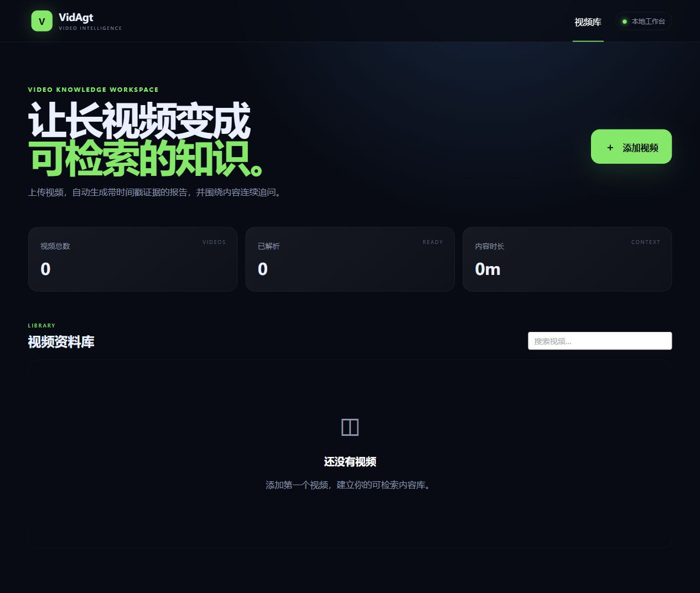
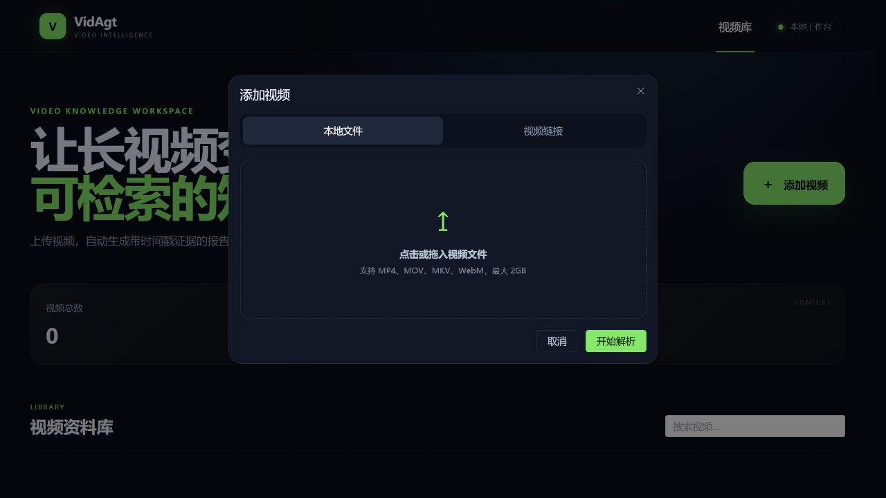

# VidAgt

VidAgt 是一个使用 Python、FastAPI 与 LangGraph 实现的长视频理解工作台。它把视频转换为带时间戳的多模态证据，自动生成结构化报告，并允许围绕同一视频继续追问。

## 项目预览

### 全链路工作流


图中按用户、Vue3 前端、FastAPI、Celery/Redis、媒体处理 Worker、LangGraph/模型服务与 MySQL/MinIO 划分泳道，同时标出上传恢复、内容去重、失败重试和证据化追问路径。

### Web 工作台

| 视频资料库 | 视频导入 |
| --- | --- |
|  |  |
| 汇总视频数量、解析状态和内容时长 | 支持本地文件与视频链接两种导入方式 |

## 已实现能力

- MinIO Multipart Upload：16MiB 分片、并发直传、刷新后查询缺失分片并续传。
- 链接导入：通过 yt-dlp 异步下载单个公开视频。
- Celery 媒体流水线：探测、SHA-256 去重、转码、音频提取、ASR、关键帧、视觉理解、时间轴融合和语义块。
- 本地 ASR：faster-whisper 自动检测 CUDA，CPU 自动回退小模型。
- 模型解耦：所有文本、视觉和 Embedding 调用统一走 OpenAI-Compatible 接口，硅基流动只是默认示例。
- LangGraph Agent：Planner → Executor → Critic → 最多两轮定向修订 → 结构化报告。
- 证据检索：关键词与向量相似度混合排序，结论引用 ASR/VISION 证据 ID 和时间戳。
- 连续追问：持久化对话与证据快照，刷新后恢复会话，并用最近历史辅助检索。
- 资源保护：Redis Lua 令牌桶、模型指数退避重试和 URL 导入公网地址校验。
- Vue 3 工作台：视频库、上传、任务进度、播放器、报告、证据时间轴、自定义分析和追问。

首版定位为本机或局域网单人工作台，不包含登录、注册和多租户权限。

## 技术栈

- 后端：Python 3.12、FastAPI、SQLAlchemy、Celery、LangGraph
- 数据：MySQL、Redis、MinIO
- 媒体：FFmpeg、faster-whisper、OpenCV
- 前端：Vue 3、TypeScript、Vite、Pinia、Element Plus
- 部署：Docker Compose，提供 CPU 与 NVIDIA GPU 两种媒体 Worker

说明：MinIO 官方在安全版本后转为仅发布源码；本项目本地开发环境固定使用公开源码与 CI 的 `alpine/minio:RELEASE.2025-10-15T17-29-55Z` 构建，不跟随 `latest` 标签。

## 快速启动

### 1. 前置要求

- Docker Desktop 及 Docker Compose
- GPU 模式额外需要 NVIDIA 驱动和 Docker GPU 支持
- 至少 12GB 可用内存；首次 ASR 会下载模型，请预留磁盘空间

### 2. 配置

```powershell
Copy-Item .env.example .env
```

编辑 `.env`，至少设置一组 OpenAI-Compatible 模型配置。阿里云百炼示例：

```dotenv
AI_API_KEY=你的百炼密钥
AI_BASE_URL=https://{WorkspaceId}.cn-beijing.maas.aliyuncs.com/compatible-mode/v1
LLM_MODEL=qwen3.8-27b
VISION_MODEL=qwen3.8-27b
EMBEDDING_MODEL=text-embedding-v4
EMBEDDING_DIMENSION=1024
```

硅基流动示例：

```dotenv
AI_API_KEY=你的密钥
AI_BASE_URL=https://api.siliconflow.cn/v1
LLM_MODEL=deepseek-ai/DeepSeek-V3.2
VISION_MODEL=Qwen/Qwen3-VL-30B-A3B-Instruct
EMBEDDING_MODEL=BAAI/bge-m3
```

如暂不配置 `AI_API_KEY`，仍可测试上传、转码和本地 ASR，但不会执行视觉描述、向量化和 Agent 报告。

### 3. CPU 模式

```powershell
docker compose up --build
```

Docker Hub 网络不稳定时，可使用带顺序拉取和三次重试的一键脚本：

```powershell
.\scripts\docker-bootstrap.ps1
```

### 4. RTX GPU 模式

```powershell
docker compose -f docker-compose.yml -f docker-compose.gpu.yml up --build
```

服务地址：

- Web 工作台：http://localhost:8080
- FastAPI 文档：http://localhost:8000/docs
- MinIO 控制台：http://localhost:9001
- MySQL（宿主机）：`localhost:3307`（可通过 `.env` 的 `MYSQL_HOST_PORT` 修改）

如需从局域网其他设备访问，在 `.env` 中把 `MINIO_PUBLIC_ENDPOINT` 改为宿主机可访问地址，例如 `http://192.168.1.20:9000`；同时把实际 Web Origin 加入 `CORS_ORIGINS` 并重启 `api`。API 启动时会幂等创建 Bucket 并同步 MinIO CORS。否则浏览器拿到的预签名上传地址会仍指向自身的 `localhost`，或被 CORS 拦截。

### 5. 停止服务

```powershell
docker compose down
```

数据位于 Docker volumes 中，`down` 不会删除数据；只有显式执行 `docker compose down -v` 才会清空数据库和对象存储。

## 开发命令

后端静态检查和测试：

```powershell
cd backend
python -m venv .venv
.\.venv\Scripts\Activate.ps1
pip install -e ".[dev,media]"
ruff check app tests
pytest
uvicorn app.main:app --reload
```

前端：

```powershell
cd frontend
corepack enable
pnpm install --frozen-lockfile
pnpm run dev
pnpm run build
```

完整的本地静态验收可在项目根目录执行 `./scripts/verify.ps1`，结果和仍需人工联调的项目记录在 `docs/acceptance.md`。

## 文档

- [架构与处理流程](docs/architecture.md)
- [阶段验收清单](docs/acceptance.md)
- [开发日志](docs/development-log.md)
- [简历描述草稿](docs/resume.md)

## 使用边界

- 默认限制单文件 2GB、视频时长 3 小时。
- 链接导入只接受 HTTP/HTTPS，并关闭播放列表下载。
- 仅处理你有权访问和分析的视频内容。
- 当前版本面向本机/局域网，不应直接暴露到公网。
