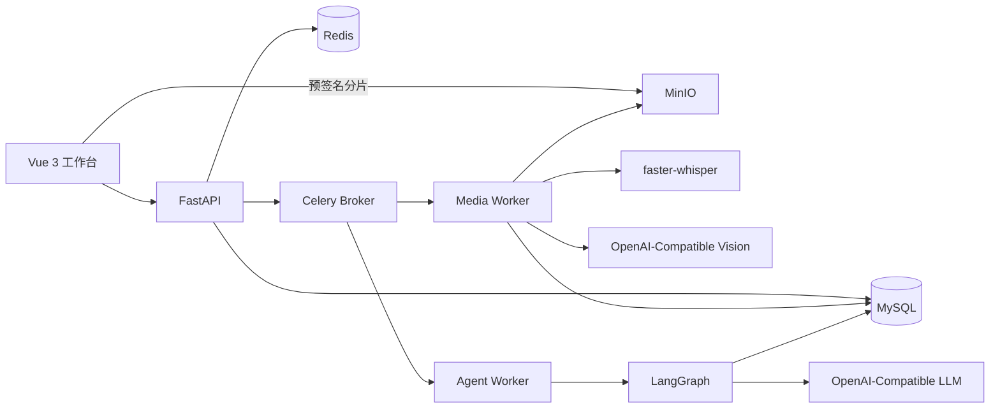
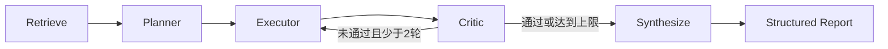

# VidAgt 架构说明

更新日期：2026-09-25

## 1. 设计目标

VidAgt 将“上传视频后等待一个超长 HTTP 请求”的串行流程拆分为可观察、可恢复的异步阶段。API 只创建上传会话或任务；文件传输直达 MinIO，媒体解析和 Agent 分析由独立 Celery Worker 执行。

核心目标：

1. 2GB / 3 小时视频可分片上传和断点续传；上传恢复与处理失败重跑是两个独立机制。
2. 视频处理不占用 API 请求线程。
3. 相同视频并发提交时只执行一套高成本处理。
4. 报告结论必须能追溯到时间戳证据。
5. 同一 VideoContext 可用于自动报告、自定义分析和连续追问。

## 2. 组件关系

MySQL 是业务状态的最终来源；Redis 用于任务队列、结果后端、分布式租约和全局 AI 限流；MinIO 保存源视频、浏览器预览与关键帧。

## 3. 上传与断点续传

1. 前端根据文件名、大小、修改时间以及首尾各 1MiB 内容生成快速指纹。
2. `POST /uploads` 创建或复用上传会话，返回 16MiB 分片大小。
3. 前端通过 `GET /uploads/{id}` 查询 MinIO 已接收分片。
4. API 批量签发 `upload_part` 地址，浏览器以 4 路并发直传 MinIO。
5. 前端收集每个分片的 ETag 后调用 `complete`；API 创建视频和 Celery 任务并立即返回。
6. Worker 下载完整对象并计算全量 SHA-256，快速指纹不参与最终内容去重。

## 4. 媒体流水线

当前实现的恢复边界：MinIO Multipart Upload 支持浏览器文件分片续传；Celery 负责任务级失败重试和失败状态记录。处理任务目前使用临时工作目录，转码、音频、ASR、抽帧和视觉处理完成后才批量持久化 VideoSegment/Keyframe/SemanticChunk，因此中途失败会从任务入口重跑，尚未实现“从上次阶段继续”的中间结果级恢复。

任务阶段及默认进度：

| 阶段 | 作用 | 进度 |
|---|---|---:|
| PROBING | ffprobe 获取时长、编码和分辨率 | 8% |
| HASHING | 计算 SHA-256 并获取内容租约 | 12% |
| TRANSCODING | 生成 H.264/AAC 浏览器预览 | 20% |
| AUDIO | 提取 16kHz 单声道 WAV | 32% |
| ASR | faster-whisper 中英文转写 | 42%–62% |
| KEYFRAMES | OpenCV 场景差异抽帧 | 62% |
| VISION | 精选关键帧画面与文字理解 | 68%–76% |
| FUSION | 按 30 秒窗口融合 ASR/VISION | 78% |
| INDEXING | 生成 5 分钟语义块和 Embedding | 90% |
| COMPLETED | VideoContext 可用于分析 | 100% |

Redis 内容锁通过随机 Token、原子 Lua 释放和周期续租实现 WatchDog 行为。每个数据库写入阶段均可重复执行；重复投递会先删除目标视频的旧中间记录再写入。

## 5. VideoContext 与检索

- `VideoSegment`：30 秒证据窗口，保存转写文本、视觉描述和关键帧对象路径。
- `SemanticChunk`：由连续 10 个 Segment 组成，即约 5 分钟；保存压缩摘要和向量。
- 检索：关键词重合分数占 40%，Embedding 余弦相似度占 60%；选中 TopK 语义块后仅加载与各命中区间重叠的原始 Segment，避免不连续命中时夹带中间无关内容。
- 模型未配置时仍生成纯文本语义块，但只进行关键词检索。

视频上限为 3 小时，因此语义块通常不超过 36 个。首版直接在应用层进行混合排序，减少专用向量数据库依赖；数据规模扩大后可平滑替换为 Redis Search、pgvector 或 Qdrant。

## 6. LangGraph 工作流

- Planner：把目标拆分为 1–5 个可由视频证据完成的任务。
- Executor：逐任务生成结论、证据 ID 和置信度，不开放数据库或任意代码执行工具。
- Critic：由模型根据目标覆盖、结论完整性和证据一致性输出结构化反馈；当前最多两轮修订是成本上限，不等同于基于离线评估指标的自适应停止。
- Synthesize：输出标题、摘要、章节、关键结论、行动项和建议。
- 服务端会过滤模型生成的无效证据 ID，防止报告引用不存在的内容。

模型调用集中在 `AIProvider`，只依赖 OpenAI-Compatible Chat、Vision 和 Embedding 接口。硅基流动是默认示例而不是业务依赖。

## 7. 可靠性策略

- Celery 使用 JSON 序列化、延迟确认、Worker 丢失重投、单媒体 Worker 预取。
- 外部模型调用最多重试 5 次，并采用随机指数退避。
- 文本、视觉和 Embedding 调用统一覆盖连接失败、超时、429 与服务端错误重试。
- Redis Lua 令牌桶限制高成本 AI 入口，令牌按时间连续回填，避免固定窗口边界突发。
- Celery 任务失败保存错误文本，前端可重新发起处理。
- Redis 开启 AOF 且使用 `noeviction`，避免队列消息因内存策略被淘汰。
- 删除视频时检查共享预览和关键帧引用，避免破坏去重后复用的上下文。
- URL 导入在 API 入队和 Worker 下载前校验 DNS/IP，拒绝非公网地址，降低 SSRF 风险。

阶段恢复的后续设计（尚未作为当前能力承诺）：为每个 `(video_sha256, pipeline_version, stage)` 建立检查点和产物清单；Segment/Keyframe/Embedding 按窗口增量入库，任务重试时先读取已完成窗口，跳过成功阶段，仅重跑缺失或版本不匹配的窗口。

## 8. 对话记忆

- Conversation 与 Message 持久化到 MySQL，消息保留回答所引用的证据快照。
- 每次追问加载最近 12 条消息并裁剪至 6000 字符，用于理解代词和上下文；检索查询同时拼接近期用户问题。
- 前端使用视频维度的会话 ID 恢复最近 50 条消息，刷新页面后可继续原会话。
- 对话历史只辅助理解问题，事实回答仍被约束为必须来自当前检索到的视频证据。

## 9. 当前取舍

- 不实现登录注册：产品限定为单人本地工作台。
- 不引入 PaddleOCR：视觉模型统一承担画面描述和文字读取。
- 不引入 Prometheus：首版使用数据库任务状态、Celery 日志和 SSE 进度；真实部署需要时再增加指标系统。
- LangGraph 首版使用进程内 Checkpointer，最终报告和任务计划持久化到 MySQL；后续需要节点级跨进程恢复时可替换 Redis/PostgreSQL Checkpointer。
- 不把任务级重试描述为阶段恢复：当前版本优先保证失败可见、可重试和结果幂等，窗口级检查点属于下一阶段工程。

## 10. 前端交付策略

- 页面路由采用动态导入，视频库与工作区按访问路径拆包。
- Element Plus 仅注册实际使用的 8 个组件及 Message/MessageBox 样式，不全量注入组件库。
- pnpm lockfile 固定依赖树，`pnpm-workspace.yaml` 仅允许 esbuild 执行安装脚本。
- Docker 构建通过 Corepack 使用指定 pnpm 版本和 `--frozen-lockfile`，确保本地与容器依赖一致。
- 当前生产构建主入口约 321KB（gzip 116KB），页面业务包分别约 9KB 和 22KB。
